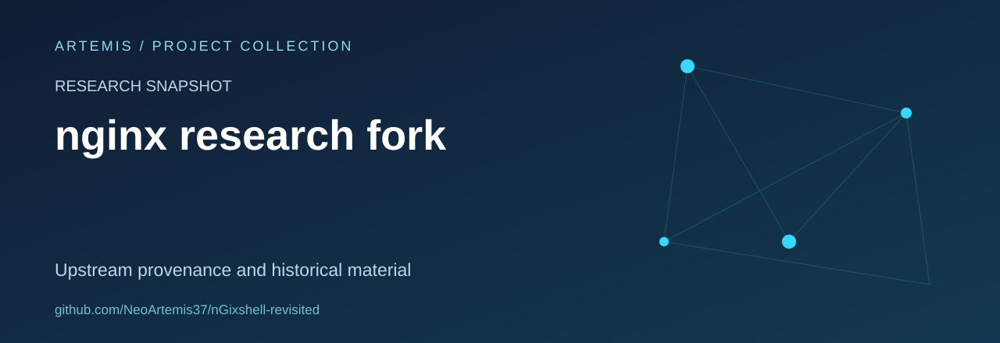

# nginx research fork

A personal fork of MateusVerass/nGixshell.

## Scope and status

This is a third-party research snapshot, not an original product or a validated security advisory by Artemis. Historical vulnerability counts, identifiers and impact claims have not been independently established in this documentation refresh.

## Repository contents

Existing Python research material and environment configuration. The code and its history are retained; this README is a presentation and provenance update.

## Review priorities

- Document the exact provenance and the limits of historical claims.
- Separate reproducible observations from assumptions.
- Prefer defensive analysis, local fixtures and clear remediation notes.

## Upstream

Forked from [MateusVerass/nGixshell](https://github.com/MateusVerass/nGixshell). Upstream authorship and licensing remain with the original project.

## Attribution and licensing

No new license or authorship claim is introduced by this documentation update. Verify the provenance and applicable permissions before reuse.

## About this collection

Maintained as part of [Artemis’s project and learning collection](https://github.com/NeoArtemis37).
